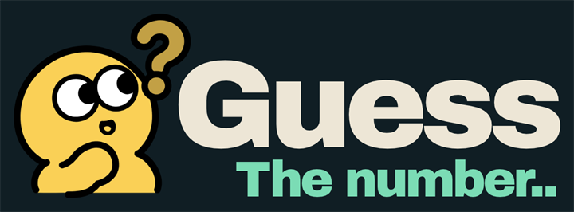

  

# Guess the Game

## GUESSING GAME 3.0

Project overview, goal and purpose

Last updated: 24 November 2026

---

## 1. WHAT IT IS

A number guessing game for the web. The player picks a username,
chooses a level, and tries to find a hidden number in as few guesses
as possible. The fewer the guesses, the higher the rank on that
level's leaderboard.

History:
- Guessing Game 2.0 (July 2025): HTML5, Tailwind and JavaScript, live
  on Vercel. Three levels (easy, medium, hard), UI improvements,
  cleaner code, and Enter/Return to submit a guess.
- Guessing Game 3.0 (November 2026): rebuilt in React with usernames,
  per-level leaderboards, a redesigned UI, badges, a win celebration,
  and a logo.

## 2. GOAL AND PURPOSE

The goal is to give people something short and satisfying to do in
place of doomscrolling when they are bored. The ideas behind it:

- Shifts the brain into an active mode. Doomscrolling is passive and
  reactive. Reasoning about numbers (narrowing a range, spotting
  patterns, remembering earlier guesses) asks for active
  problem-solving and working memory.

- Gives a clear stopping cue. Social feeds scroll forever. A guessing
  game has a definite end: once the number is found, the round is
  over and the loop closes.

- Reduces passive overstimulation. A single-focus logic puzzle is a
  break from rapid-fire video and constant novelty.

Honest framing: this is a short-term bandaid, not a solution to
brainrot, boredom or doomscrolling. The brain-network and dopamine
points are the intention behind the design, not something this game
has been shown to achieve. The stopping cue is the strongest and most
concrete of the three, because every round really does end.

A thing to keep in mind: the leaderboard, badges and celebration are
also reasons to come back. Each round still ends naturally, but if the
"stopping cue" matters, consider a gentle prompt such as "You've played
5 rounds. Take a break?"

## 3. WHAT HAS BEEN BUILT

### Phase 1 - React port (done)
- Vite + React + Tailwind CSS.
- Three levels: Level 1 (0-100), Level 2 (0-500), Level 3 (0-1000).
- Routes: /play/1, /play/2, /play/3. Visiting / goes to Level 1.
- Enter/Return submits a guess. Invalid input shows a message and
  does not count as an attempt.
- Play again resets the round. Next level appears on levels 1 and 2.
- vercel.json rewrites all routes so refreshing a page does not 404.
- Old v2 files kept in the legacy/ folder.

### Phase 2 - Username screen (done)
- First-time visitors pick a name (3-16 characters: letters,
  numbers, underscore, dash) before playing.
- Direct links such as /play/2 ask for a name first, then continue
  to that level.
- Change name is available from the game header.
- Usernames are compared case-insensitively. The typed case is kept
  for display.

### Phase 3 - Supabase scores and leaderboard (done)
- Supabase (Postgres) stores players and scores.
- Saving a name creates the player, or adopts an existing player
  with the same name (with a notice that scores add to that name).
- A win saves a score. If saving fails, the game keeps working.
- /leaderboard shows the top 10 per level (best score per player,
  earliest date breaks ties), with a "You" marker on your row.
- Row Level Security is on for all tables.

### Phase 4 - Badges (done)
- Seven badges: First win, Sharp, Near perfect, Lucky guess, Hard
  mode cleared, All levels cleared, and Top 10.
- Badges are computed on read from scores, plus the leaderboard view
  for Top 10. They are not stored. player_badges is unused on purpose:
  its insert policy is open, so stored badges could be faked.
- The win screen shows up to three new badges, rarest first, then
  "+N more, see the leaderboard". The leaderboard page shows all seven
  with explicit Earned/Locked labels, never color alone.
- The baseline comes from the first successful badge load. A failed
  first fetch or a failed save shows no new badges for that round.
- Save status and new badges share one live region, so they are
  announced together.
- Top 10 is a current-standing badge and can disappear when someone
  beats your score.

### Design pass (done)
- Restyled the username screen, game, leaderboard and rename dialog
  with a retro monospace feel: navy background, amber accent, mint
  green for the big answer number.
- Sentence-case copy, buttons that say what they do ("Guess",
  "Play again", "Next level", "Save name").
- Responsive layout, visible focus states, "Made by revs" footer.

### Branding and logo (done)
- The header uses the supplied "Guess / The number." lockup on the
  game, username and leaderboard screens, through one BrandLogo
  component. It sits inside the h1 with real alt text, so the heading
  is still announced as "Guess The Number".
- The supplied logo2.png was 2000x2000 with the artwork in the middle.
  It is cropped to the artwork (720x266) so it reads at header size;
  its background matches ink exactly, so there is no visible seam.
- The favicon uses logo.svg.
- Note: the full lockup favicon is hard to read at 16px and low
  contrast on a light tab bar. A face-only variant is an easy
  follow-up if wanted.

### Win celebration (done)
- One burst of balloons on a win, in three tiers based on how close
  the win was to the optimal number of guesses (normal, sharp, near
  perfect), with a glow on the answer number.
- Presentation only: aria-hidden, no sound, and fully hidden under
  prefers-reduced-motion.
- npm run build passes. A final play-test at 360px and with reduced
  motion on is still worth doing.

## 4. TECH STACK

- Frontend: Vite, React, react-router-dom, Tailwind CSS
- Backend/database: Supabase (Postgres, Row Level Security)
- Hosting: Vercel
- Built with: opencode (AI coding agent) and VS Code
- Structure: Supabase calls live only in src/lib/supabase; game logic
  lives in hooks (useGame, usePlayer); components handle UI.
- Database: players, scores, badges, player_badges, plus a
  leaderboard view. Migrations are in supabase/migrations. Badge
  state is derived on read from scores and the leaderboard view, so
  the badges and player_badges tables are currently unused.
- Brand assets: public/brand/logo.png (header lockup) and
  public/brand/logo.svg (favicon).
- Secrets: VITE_SUPABASE_URL and VITE_SUPABASE_ANON_KEY go in
  .env.local (never committed). The same two variables must be added
  in Vercel for deployments and previews.

## 5. KNOWN LIMITS

- No login. Anyone can type a name that is already taken and add
  scores to it.
- Scores are sent from the browser, so a technical user could submit
  a fake result. The planned fix is validating the game on the server
  (a Supabase function).
- Badges are derived from data the browser can read, so Top 10 can
  change under you. Stored badges are intentionally not used.
- The favicon uses the full lockup, which is hard to read at 16px.

## 6. NEXT STEPS

1. Commit the badge and branding work on the design-pass branch.
2. Play-test: the win celebration (quick and slow win, 360px, reduced
   motion on), new badges after a win, an offline save followed by
   Retry, and the leaderboard badge strip.
3. Check the Vercel preview of the design-pass branch (confirm the
   Supabase environment variables are set for Preview).
4. Merge design-pass into main for the production deploy.
5. Phase 5: server-side validation of results (a Supabase function).
6. Optional: a face-only favicon, login, and a "take a break" prompt
   to support the stopping-cue purpose.
7. Read through useGame.js and usePlayer.js to understand the logic
   well enough to explain it yourself.

After that we're done with the project, ready for deployment.

## 7. PROGRESS LOG

### 24 November 2026
- Phase 4 badges implemented and the badge rules verified with 14
  Node checks. npm run build passes.
- Header lockup and favicon wired. Old generated logo assets and the
  logo generator removed; the local logo review page updated.
- Win celebration confirmed built with the reduced-motion guard.
